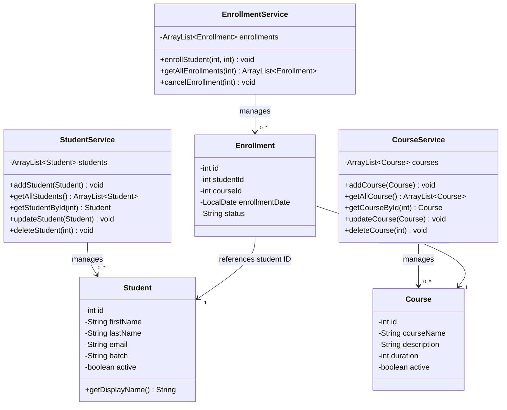

# LearnTrack — Student & Course Management System

## Project description
LearnTrack is a simple Java console application that helps us manage students and courses.

We can add students view their details, search for students, update their information and enroll them in courses. We can also manage courses and check which courses a student has joined.
The application stores data temporarily in an ArrayList. This means that data stays available while the program is running. We do not use a database in this project.

## Features
1. Student Management
- Add a new student
- View the list of students.
- Search for a student using their ID.
- Update student details.
- Delete a student when there are no longer active.

2. Course Management
- Add a new course.
- View available courses.
- Activate or Delete a course.

3. Student Enrollment
- Enroll a student in a course.
- View the courses a student has joined.
- Mark an enrollment as completed when the student finishes the course.
- Cancel an enrollment when the student leaves the course.

4. Error Handling
- Display a helpful message when the user enters an invalid menu option.
- Show an appropriate message when a student or course ID does not exist.
- Handle situations where no students or courses are available.

## Package structure
```text
src/
└── com/
    └── airtribe/
        └── learntrack/
            ├── entity/       # Student, Course, Enrollment, and related domain classes
            ├── service/      # Application/business logic
            ├── ui/           # Main.java and console menu
            ├── exception/    # Custom exceptions
            └── util/         # ID generation and input validation helpers
docs/
    ├── Setup_Instructions.md
    ├── JVM_Basics.md
    └── Design_Notes.md
README.md
```

## How to compile and run
Open a terminal in the project root.

### Compile
For a simple source layout where Java files are under `src/`, run:

```bash
javac -d out src/com/airtribe/LearnTrack/**/*.java
```

Some Windows shells do not expand `**` recursively. If that command does not work, use the IDE to build the project or compile all `.java` files using your shell's file-search command.

**PowerShell alternative:**
```powershell
$files = Get-ChildItem -Path src -Recurse -Filter *.java | ForEach-Object { $_.FullName }
javac -d out $files
```

### Run
```bash
java -cp out com.airtribe.LearnTrack.ui.Main
```

If your main class has a different package or class name, update the run command accordingly.

## Class diagram


## Design overview
- Entity classes: represent domain data.
- Service classes: contain business logic and manage in-memory collections.
- UI class: displays menus, reads input, and calls service methods.
- Exception classes: represent expected application errors, such as an entity not being found.
- Utility classes: provide reusable helpers such as ID generation and input validation.

