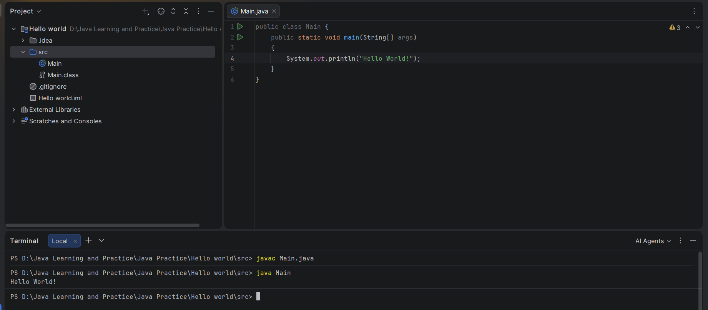

# Setup Instructions

## 1. Prerequisites
   Install a Java Development Kit (JDK). A JDK includes the compiler (`javac`) and the Java runtime tools required to build and run this project. 

## JDK version used
`25.0.4.1`

## Screenshots or brief explanation of “Hello World” program run.
I created a simple Java program to check whether Java was installed and working correctly on my computer.
How I ran the program:
1. Create a Java file named Main.java
2. Wrote the code to print Hello World! on the screen.
3. Opened the terminal in the folder containing the file.
4. Compiled the program using `javac Main.java`
5. Ran the compiled program using: `java main`
6. Output: `Hello World!`

What I learned ?
The main() method is the starting point of my Java program. The System.out.println() statement prints the given message on the console. The javac command compiles the Java source code, and the java command runs the compiled program.
This confirmed that my Java development environment was working correctly.
